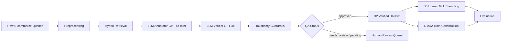

# Dataset Annotation Pipeline Evaluation

> File này dùng làm nội dung đầu vào cho AI tạo slide PPTX.  
> Chủ đề: quy trình lấy dữ liệu, xây taxonomy, gán nhãn intent phân cấp, verify nhãn, tạo gold test set và đánh giá chất lượng dataset.

---

## 1. Thông điệp chính

Nghiên cứu này xây dựng một dataset intent phân cấp tiếng Việt cho miền e-commerce bằng phương pháp **Verification-Guided LLM Annotation Framework**.

Thay vì chỉ dùng một lần dự đoán của LLM, pipeline kết hợp:

1. Dữ liệu câu hỏi thực tế từ e-commerce.
2. Taxonomy intent phân cấp 3 tầng: **L1 - L2 - L3**.
3. Hybrid retrieval để lấy candidate intents.
4. LLM annotator nhẹ: **GPT-4o-mini**.
5. LLM verifier mạnh hơn: **GPT-4o**.
6. Guardrails để kiểm tra taxonomy, slug, độ hợp lệ nhãn.
7. Human gold test set để đánh giá độc lập.

Mục tiêu không phải đề xuất model phân loại mới, mà là chứng minh quy trình tạo dataset có kiểm chứng giúp tăng chất lượng nhãn và giảm rủi ro sai lệch khi train classifier.

---

## 2. Slide Outline Đề Xuất

### Slide 1 - Title

**Verification-Guided LLM Annotation Framework for Vietnamese Hierarchical Intent Dataset Construction**

Subtitle:

- Dataset intent phân cấp tiếng Việt cho e-commerce.
- Từ dữ liệu thô đến D1/D2/D3 và đánh giá downstream.

Speaker notes:

- Giới thiệu bài toán: cần xây dataset intent chất lượng cao cho customer queries tiếng Việt.
- Thách thức: câu hỏi ngắn, informal, nhiều intent gần nhau, taxonomy long-tail.

---

### Slide 2 - Research Motivation

**Vấn đề cần giải quyết**

- Gán nhãn intent thủ công tốn thời gian và khó mở rộng.
- Gán nhãn bằng LLM một lượt dễ sai do overconfidence.
- Taxonomy phân cấp L1/L2/L3 cần nhãn nhất quán ở cả 3 tầng.
- Dataset train và gold test phải tách biệt để tránh data leakage.

**Ý tưởng chính**

Kết hợp LLM annotation, stronger-model verification và taxonomy guardrails để tạo dataset đáng tin cậy hơn.

---

### Slide 3 - Dataset Source

**Nguồn dữ liệu**

- Dữ liệu câu hỏi/ngữ cảnh từ miền e-commerce Hasaki.
- Mỗi mẫu gồm:
  - `sample_id`
  - `sentence`
  - `category`
  - nhãn intent L1/L2/L3
  - confidence
  - `qa_status`

**Quy mô dữ liệu nguồn**

| Thành phần | Số lượng |
|---|---:|
| D1 source | 2011 mẫu |
| D2 source | 2011 mẫu |
| D2 approved | 1737 mẫu |
| D3 human gold | 300 mẫu |
| Train pool sau khi loại D3 | 1454 mẫu |

---

### Slide 4 - Hierarchical Intent Taxonomy

**Taxonomy intent có 3 tầng**

| Level | Ý nghĩa | Ví dụ |
|---|---|---|
| L1 | Giai đoạn customer journey | `truoc_mua_hang`, `sau_mua_hang` |
| L2 | Nhóm intent chức năng | `thong_tin_san_pham`, `van_de_giao_hang` |
| L3 | Intent cụ thể | `cong_dung_san_pham`, `khieu_nai_shipper` |

**Đặc điểm**

- Taxonomy có tính long-tail.
- Một số L3 có rất ít mẫu.
- Vì vậy đánh giá cần báo cáo Macro-F1, không chỉ Accuracy.

---

### Slide 5 - Overall Pipeline



Speaker notes:

- Candidate retrieval giúp giới hạn không gian nhãn trước khi LLM dự đoán.
- Verifier đóng vai trò second opinion.
- Guardrails đảm bảo nhãn cuối cùng hợp lệ theo taxonomy.

---

### Slide 6 - Step 1: Data Preprocessing

**Mục tiêu**

Chuẩn hóa dữ liệu đầu vào để mỗi câu hỏi có thể đi qua pipeline annotation.

**Xử lý chính**

- Gán `sample_id` duy nhất cho từng câu hỏi.
- Giữ nội dung câu hỏi trong field `sentence`.
- Giữ category sản phẩm/ngữ cảnh nếu có.
- Loại hoặc đánh dấu trường hợp không đủ thông tin.
- Chuẩn bị input cho retrieval và LLM annotation.

**Output**

- Dataset nguồn có cấu trúc JSON.
- Mỗi item sẵn sàng để gán nhãn L1/L2/L3.

---

### Slide 7 - Step 2: Candidate Retrieval

**Mục tiêu**

Giảm số lượng intent candidate trước khi gọi LLM, giúp dự đoán ổn định và ít nhiễu hơn.

**Phương pháp**

- Regex retrieval: bắt tín hiệu từ keyword/rule.
- Embedding retrieval: tìm intent gần nhất theo semantic similarity.
- Hybrid retrieval: lấy union candidates từ regex và embedding.

**Vai trò trong pipeline**

- Cung cấp danh sách candidate intents cho annotator.
- Giúp LLM chọn trong không gian taxonomy hợp lý thay vì đoán tự do.

---

### Slide 8 - Step 3: LLM Annotation

**Annotator model**

- Model: `gpt-4o-mini`
- Nhiệm vụ: đọc câu hỏi và chọn intent path L1/L2/L3.

**Input cho annotator**

- User query (`sentence`)
- Category/ngữ cảnh nếu có
- Candidate intents từ retrieval
- Quy tắc taxonomy

**Output**

```json
{
  "intent_3_level": {
    "level_1": "...",
    "level_2": "...",
    "level_3": "..."
  },
  "confidence": 0.85,
  "reasoning": "...",
  "qa_status": "approved"
}
```

**Dataset tạo ra**

- **D1**: annotator-only dataset.
- D1 phản ánh chất lượng nhãn từ annotator trước khi verify.

---

### Slide 9 - Step 4: LLM Verification

**Vấn đề của annotation một lượt**

- LLM có thể tự tin cao dù nhãn sai.
- Câu hỏi ngắn hoặc mơ hồ dễ bị gán nhầm L2/L3.
- Nhãn có thể đúng tầng L1 nhưng sai tầng L2/L3.

**Verifier**

- Model: `gpt-4o`
- Vai trò: đọc lại câu hỏi, nhãn annotator, confidence, rationale và candidates.
- Quyết định:
  - `RETAIN`: giữ nhãn annotator.
  - `REVISE`: sửa lại L1/L2/L3.

**Output verifier**

```json
{
  "decision": "RETAIN | REVISE",
  "final_L1": "...",
  "final_L2": "...",
  "final_L3": "...",
  "confidence_adjusted": 0.90,
  "reason": "..."
}
```

---

### Slide 10 - Step 5: Guardrails and QA Status

**Guardrails**

Sau verifier, nhãn tiếp tục qua các kiểm tra tự động:

- L1 phải thuộc taxonomy hợp lệ.
- L2/L3 phải là slug hợp lệ.
- L3 phải cụ thể hơn L2.
- Nhãn phải tồn tại hoặc được snap về taxonomy gần nhất.
- Không tự ý thêm nhãn mới nếu chưa qua kiểm duyệt.

**QA status**

| Status | Ý nghĩa |
|---|---|
| `approved` | Nhãn đủ tin cậy để dùng |
| `needs_review` | Cần người kiểm lại |
| `pending_new_label_review` | Có khả năng là nhãn mới, cần duyệt |
| `approved_auto_new_label` | Nhãn mới được hệ thống approve theo rule |

**Dataset tạo ra**

- **D2**: verified dataset sau verifier + guardrails.

---

### Slide 11 - D1, D2, D3 Definition

| Dataset | Định nghĩa | Vai trò |
|---|---|---|
| D1 | Nhãn từ annotator GPT-4o-mini | Baseline noisy labels |
| D2 | Nhãn sau GPT-4o verifier + guardrails | Verified labels |
| D3 | 300 mẫu human gold | Test set độc lập |

**Nguyên tắc quan trọng**

- D3 không dùng để train.
- D1_train và D2_train phải dùng cùng `sample_id`.
- Mọi `sample_id` trong D3 bị loại khỏi train để tránh leakage.

---

### Slide 12 - D3 Human Gold Construction

**Mục tiêu**

Tạo một gold test set độc lập do người kiểm để đánh giá chất lượng nhãn.

**Sampling**

| Thuộc tính | Giá trị |
|---|---:|
| Số mẫu | 300 |
| Seed | 42 |
| Strategy | L2 coverage + L3 diversity + proportional L2 fill |
| Unique L1 | 2 |
| Unique L2 | 37 |
| Unique L3 | 197 |

**Phân phối L1 trong D3**

| L1 | Số mẫu |
|---|---:|
| `truoc_mua_hang` | 244 |
| `sau_mua_hang` | 56 |

**Vai trò**

- D3 dùng làm human gold benchmark nội bộ.
- D3 dùng cho RQ1/RQ3, không dùng trong training.

---

### Slide 13 - Train Set Construction and Leakage Control

**Tiêu chí tạo train pool**

```text
matched_train_ids = D2 approved IDs - D3 IDs
```

**Số liệu**

| Bước | Số mẫu |
|---|---:|
| D2 total | 2011 |
| D2 approved | 1737 |
| D3 human gold | 300 |
| D3 IDs nằm trong D2 approved | 283 |
| Train pool cuối cùng | 1454 |

**Leakage check**

- `D1_train ∩ D3 = 0`
- `D2_train ∩ D3 = 0`
- `D1_train IDs == D2_train IDs`

**Ý nghĩa**

Mô hình train trên D1 hoặc D2 đều được đánh giá trên cùng D3 mà không bị trùng mẫu.

---

### Slide 14 - Evaluation Questions

**RQ1: Verification có cải thiện chất lượng nhãn không?**

So sánh:

- D1 labels vs D3 human gold.
- D2 labels vs D3 human gold.

**RQ2: Verification có giảm khối lượng human review không?**

So sánh phân phối `qa_status` trước/sau verifier:

- approved
- needs_review
- pending_new_label_review

**RQ3: Verified labels có giúp downstream classifier tốt hơn không?**

Train cùng model trên:

- D1_train
- D2_train

Evaluate trên:

- D3 human gold

---

### Slide 15 - Evaluation Metrics

**Per-level metrics**

Báo cáo riêng cho L1, L2, L3:

- Accuracy
- Macro-F1
- Weighted-F1

**Vì sao cần Macro-F1?**

- Dataset long-tail mạnh.
- Nhiều L3 có ít mẫu.
- Accuracy hoặc Weighted-F1 có thể bị chi phối bởi class phổ biến.

**Hierarchical metric**

Full-Path Accuracy:

```text
Prediction is correct only if:
pred_L1 == gold_L1
AND pred_L2 == gold_L2
AND pred_L3 == gold_L3
```

---

### Slide 16 - Downstream Baselines

**Classical baseline**

- TF-IDF + Linear SVM
- Train trên D1_train hoặc D2_train
- Test trên D3

**Transformer baseline**

- PhoBERT-base
- XLM-R-base
- Train cùng hyperparameters cho D1_train và D2_train

**Mục tiêu**

Kiểm tra xem nhãn đã verify có giúp classifier học tốt hơn nhãn annotator-only không.

---

### Slide 17 - Expected Result Tables

**Table 1 - Dataset statistics**

| Dataset | N | L1 | L2 | L3 |
|---|---:|---:|---:|---:|
| D1 full | 2011 | ... | ... | ... |
| D2 full | 2011 | ... | ... | ... |
| D3 gold | 300 | 2 | 37 | 197 |
| D1_train | 1454 | ... | ... | ... |
| D2_train | 1454 | ... | ... | ... |

**Table 2 - Label quality vs D3**

| Dataset | L1 mF1 | L2 mF1 | L3 mF1 | Full-path |
|---|---:|---:|---:|---:|
| D1 Annotator | ... | ... | ... | ... |
| D2 Verified | ... | ... | ... | ... |

**Table 3 - Downstream classification**

| Train Set | Model | L1 mF1 | L2 mF1 | L3 mF1 | Full-path |
|---|---|---:|---:|---:|---:|
| D1_train | TF-IDF+SVM | ... | ... | ... | ... |
| D2_train | TF-IDF+SVM | ... | ... | ... | ... |
| D1_train | PhoBERT | ... | ... | ... | ... |
| D2_train | PhoBERT | ... | ... | ... | ... |

---

### Slide 18 - Methodological Strengths

**Điểm mạnh của phương pháp**

- Có gold test set độc lập do người kiểm.
- D1 và D2 dùng cùng sample IDs khi train, giúp so sánh công bằng.
- Có kiểm soát data leakage rõ ràng.
- Verifier và guardrails giúp giảm lỗi taxonomy.
- Báo cáo metric theo từng tầng hierarchy, không chỉ L3.
- Full-path accuracy đánh giá nghiêm ngặt toàn bộ intent path.

---

### Slide 19 - Limitations

**Hạn chế**

- Dataset hiện tập trung vào một domain e-commerce cụ thể.
- L3 long-tail làm việc train classifier khó hơn.
- Một phần gold labels có thể cần human review nhiều vòng để tăng độ chắc chắn.
- Chi phí verifier tăng vì phải gọi model mạnh hơn.
- Benchmark hiện là benchmark nghiên cứu nội bộ, chưa phải benchmark công khai chuẩn cộng đồng.

---

### Slide 20 - Conclusion

**Kết luận**

Pipeline này xây dựng dataset intent phân cấp tiếng Việt bằng cách kết hợp LLM annotation, LLM verification và taxonomy guardrails.

Kết quả chính cần chứng minh:

1. D2 verified labels gần với D3 human gold hơn D1 annotator labels.
2. Verification giúp giảm lỗi nhãn ở L2/L3.
3. Classifier train trên D2_train đạt Macro-F1 và Full-path Accuracy tốt hơn train trên D1_train.
4. Quy trình tách D3 khỏi train giúp đánh giá đáng tin cậy, không bị leakage.

---

## 3. Phương Pháp Viết Trong Paper / Slide

### 3.1 Dataset Construction

We constructed a Vietnamese hierarchical intent dataset from real-world e-commerce customer queries. Each query was mapped to a three-level intent taxonomy consisting of high-level customer journey stages, functional intent categories, and fine-grained intent labels. The dataset was processed through a verification-guided annotation pipeline to produce annotator-only labels, verified labels, and an independent human gold test set.

### 3.2 Annotation Framework

The annotation framework consists of four main components: hybrid candidate retrieval, lightweight LLM annotation, stronger-model cross-verification, and taxonomy guardrails. First, candidate intents are retrieved using lexical and semantic signals. Then, GPT-4o-mini predicts the most suitable L1-L2-L3 intent path. Next, GPT-4o verifies the predicted label and either retains or revises it. Finally, taxonomy guardrails validate the output and assign a QA status.

### 3.3 Gold Test Set

To evaluate annotation quality independently, we constructed a 300-sample human gold test set. Samples were selected using a fixed seed and a strategy designed to maximize L2 coverage, preserve L3 diversity, and maintain proportional representation across frequent L2 classes. The gold set was excluded from all training sets.

### 3.4 Evaluation Design

We evaluate the framework in two ways. First, we compare D1 annotator-only labels and D2 verified labels against the D3 human gold labels. Second, we train downstream classifiers on D1_train and D2_train using the same sample IDs, then evaluate both models on D3. This setup isolates the effect of label quality while avoiding data leakage.

### 3.5 Metrics

For each hierarchy level, we report Macro-F1 and Weighted-F1. We also report Full-Path Accuracy, where a prediction is counted as correct only if L1, L2, and L3 are all correct simultaneously. Macro-F1 is emphasized because the dataset contains a long-tail distribution of fine-grained L3 intents.

---

## 4. Prompt Gợi Ý Để Tạo PPTX Bằng AI

Copy đoạn dưới đây vào công cụ AI tạo slide:

```text
Create a professional research presentation in Vietnamese based on the Markdown content below.

Presentation style:
- Academic but clear.
- Use simple diagrams, process flow, and tables.
- Use a clean blue/white theme.
- Convert each "Slide" section into one slide.
- Keep each slide concise, with 4-6 bullet points maximum.
- Add speaker notes based on the notes when available.

Topic:
Verification-Guided LLM Annotation Framework for Vietnamese Hierarchical Intent Dataset Construction.

Key points to emphasize:
1. Dataset source and hierarchical taxonomy L1/L2/L3.
2. Hybrid retrieval + GPT-4o-mini annotation + GPT-4o verification + guardrails.
3. D1/D2/D3 dataset design.
4. D3 human gold set and leakage control.
5. Evaluation metrics: Macro-F1, Weighted-F1 for L1/L2/L3, and Full-Path Accuracy.
6. Downstream comparison between D1_train and D2_train.

Generate a PPTX-ready slide deck with title, agenda, method, evaluation, and conclusion.
```

---

## 5. Checklist Trước Khi Trình Bày

- Cập nhật số liệu cuối cùng từ `notebooks/train_eval_colab.ipynb`.
- Điền kết quả thật vào Table 2 và Table 3.
- Kiểm tra lại không có D3 IDs trong D1_train/D2_train.
- Thống nhất thuật ngữ:
  - D1 = annotator-only
  - D2 = verified
  - D3 = human gold
- Nếu công bố dataset, cần bổ sung license và mô tả privacy/anonymization.

